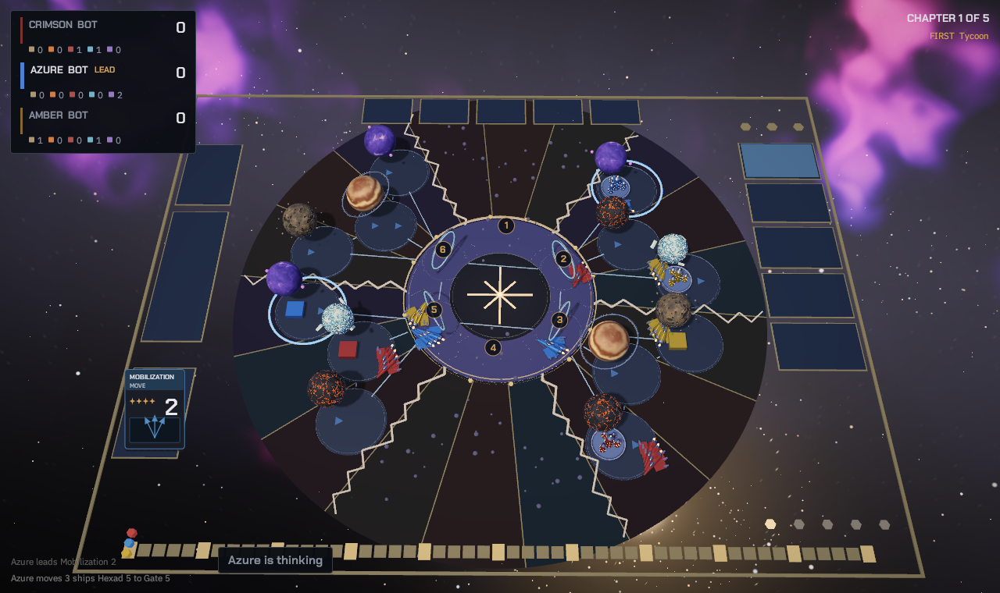
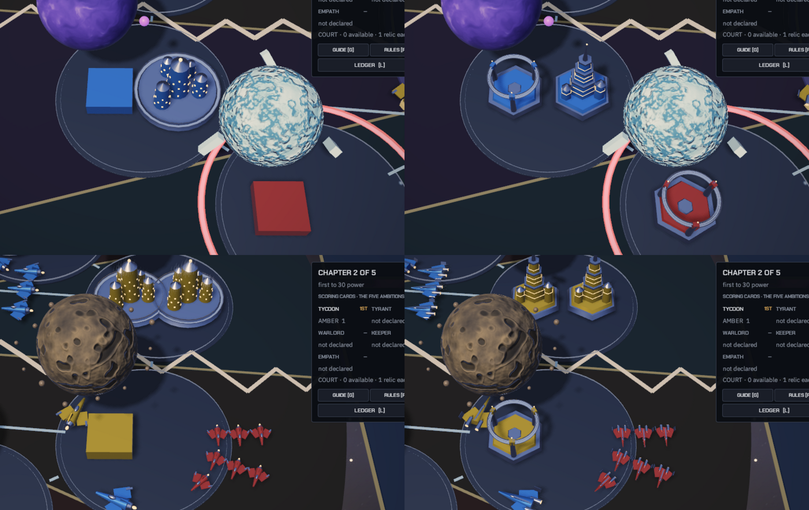

# Parabola: Ember Reach

A bird's-eye 3D tabletop strategy game on the [Dust engine](https://github.com/suspiciousMans/dust-engine),
with all rules written in [Oxidized](https://github.com/suspiciousMans/oxidized). It is an original game in the
style of trick-taking action-card area-control games: lead or follow an action card, spend its actions
moving, fighting and building across a ring of star systems, win tricks to hold the initiative, and
score the declared ambitions at the end of each of five chapters.



## Play

```
cargo run --release -p ember_reach
```

Pick 2 to 4 players, each Human or Bot (hot-seat asks the next human to confirm before showing their hand).

| Camera | |
|---|---|
| Right-drag | orbit |
| Middle-drag or WASD / arrows | pan |
| Wheel | zoom |
| Q / E | quarter turns |
| Space | back to the overview |
| Double-click a system | glide to it |
| Click a system | filter the action list to it |

## Rules in one screen

* Deal: 6 action cards each (4 suits: Move, Fight, Build, Influence; ranks 1 to 7).
* A trick: the holder of the initiative leads a card and takes **2 actions** of its suit. Everyone else plays in
  turn order and takes **1 action**: they must follow the lead suit if they can, otherwise they may pivot with any
  card and take an action of *that* card's suit. The highest card of the lead suit wins: +1 power and the lead.
* Actions: **Tax** for a resource at a system where you have a city; **Build** a city or starport on a system where
  you have a piece; **Build ships** at your starport from reserve; **Move** ships along a lane (a starport lets
  them take any path); **Repair** one damaged piece; **Battle** with assault, skirmish and raid dice. A **Prelude**
  spends a resource for an extra action; Relics are reserved for the Court.
* Court: five face-up court cards sit on the board. In your action step, spend 1 Relic to secure one; it
  leaves the row and stays in your player panel, scoring 1 power. The row is not refilled.
* After 6 tricks the chapter's declared ambitions score their marker values, then cities pay 1 power each.
  The game ends when a player reaches the power goal at a chapter end, or after five chapters; most power wins.

The rules are a plain, testable library: `rules/ox/reach.ox` (Oxidized), 14 tests in `rules/ox/tests/`.

## Layout

```
rules/   reach_rules crate
  ox/reach.ox          the rules (state = flat list of ints, actions = [kind, a, b])
  ox/tests/            `oxidized test rules/ox/tests`
  ox_gen/reach_gen.rs  committed transpiled copy, used when no `oxidized` binary is installed
  src/lib.rs           typed wrapper: State, Action, Event, validate(); serde, so it can be saved or sent
game/    ember_reach crate (Dust game)
  src/models.rs        procedural ships, cities, starports, platforms: no asset files
  src/camera.rs        orbit / pan / zoom / glide camera (tested)
  src/ui.rs            egui menu, scoreboard, Court row, hand, action list, log
  src/courtart.rs      procedural Court card emblems (no image assets)
  src/fieldmanual.rs   rulebook and step-by-step tutorial
  src/guides.rs        toggleable labels for the board's key areas
web/     browser build: index.html, build.sh, web_smoke.js
src/     the site: Cloudflare Worker (rooms, validation, bots), page client, game.ts hosts the 3D board
scripts/ build-game.sh (3D board for the site), build-worker.mjs, build-rules-wasm.sh
```

After editing `rules/ox/reach.ox`, run `rules/regen.sh` (needs `oxidized`; set `OXIDIZED=/path/to/oxidized`)
to run the Ox tests and refresh the committed copy.

## Web

```
rustup target add wasm32-unknown-emscripten   # emsdk 3.1.74 tested
web/build.sh                                 # finds emsdk itself; no PATH setup
node web/web_smoke.js dist-web ember_reach shot.png    # headless Chromium: loads, plays a bot game, checks the canvas
```

`web/build.sh` and `npm run build:game` look for emsdk through `EMSDK`, `$HOME/emsdk` and `/opt/emsdk`;
if `emcc` is not there they stop with a clear `emcc not found` error. The game uses no threads, files or
native-only crates, and generates all geometry in code, so there is nothing to preload.

## The site: rooms, bots and online play

`src/` is the site. The Worker (`src/worker`) keeps rooms in D1, validates every action with the shipped
rules (`src/game/reach_rules.wasm`) and plays bot seats. The page (`src/client`) creates and joins rooms by
code; once a game starts it loads the 3D board (`src/client/public/game/`, the same Rust game built for the
browser) and the board is driven by the Worker: the Worker sends each player the state with the other hands
hidden plus the last events, the board animates them, and the player's clicks go back as actions.

```
npm ci
npm run build          # type check, page, Worker
npm run dev            # wrangler dev --local on http://localhost:3000 (D1 is emulated locally)
```

Open it in two tabs (each tab is its own player): create a room in one, join with the code in the other,
add bots if you want, start. `?classic=1` on the page shows the plain HTML board instead of the 3D one.

After changing the game, rebuild the 3D board and commit the result, so deploys
don't need Rust: `npm run build:game` finds emsdk via `EMSDK`, `$HOME/emsdk` or `/opt/emsdk`, so no PATH
setup is needed. After changing the rules run `rules/regen.sh` and
`scripts/build-rules-wasm.sh`.

## Screenshots and autoplay

`ember_reach --autoplay --shot out.png --after 60 [--focus 3]` plays 60 bot actions headlessly (use `xvfb-run`
on Linux) and saves a frame.

## Learning the game

The table has a built-in Field Manual and a board guide:

| Key | |
|---|---|
| G | label the Court, gates, ring, played cards, ambitions and power track |
| R | open the rulebook and the six-step tutorial (also on the start menu) |
| L | open the ledger: every score, resource, trophy, captive and secured card |

The Court row in the left panel shows each face-up card's art; click a card on your action step to secure it.

## Pieces

Ships, cities and starports are built in code (`game/src/models.rs`). Each piece puts team colour where it
reads from above: a frigate with a diamond hull, delta wings and twin pods; a stepped arcology on a hex plinth;
a hex pad under a raised docking ring, so a starport is told from a city at a glance.



## Not done yet

Spectators and reconnect polish, a lobby inside the 3D board (the page handles the lobby), better bots (one heuristic bot today), sound, undo.


See [docs/STYLE.md](docs/STYLE.md) for the art and UI rules.

## Rules status (Stage 1)

The rules in `rules/ox/reach.ox` follow the physical game's structure: 24 systems in six clusters
(planet types, gates, out-of-play clusters for 2/3 players), the 12 setup cards, 4-suit card play
(Lead, Surpass, Copy, Pivot, Seize, Pass), ambitions with ranked markers, resources and the prelude,
tax/build/move/repair/battle with dice, outrage, trophies and captives, Court/Secure cards, chapters and
power goals.

Interpretations not yet checked against the rulebook (please verify): Pivot gives one action of the played
card's suit; repair fixes one piece; builds cost no resources; the lead passing ends the chapter; ambition
marker ranks follow declaration order; ties for first share the second value; destroyed ships are lost;
the intercept round; catapult moves along any-length paths; seat roles A/B/C on the setup cards.
Court cards are the fixed five-card row; securing costs 1 Relic, scores 1 power and does not spend an action
pip; the row is not refilled; Guild/Vox effects are deferred.

Deferred: Guild/Vox Court effects, leaders, lore, ambition city bonuses.
